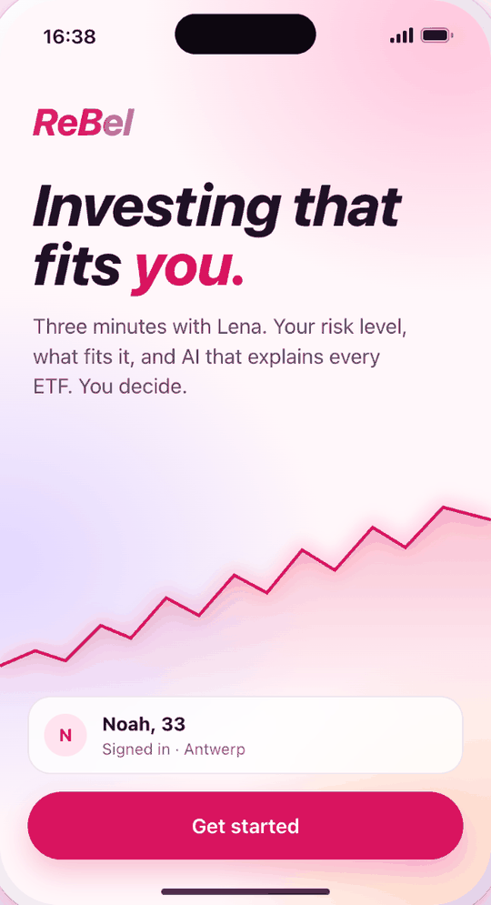

<p align="center"><b>ReBel</b> · QTEM Data Challenge 2026</p>

<h1 align="center">Investing that fits you.</h1>

<p align="center">
  Meet <b>Lena</b>, the AI coach inside ReBel.<br>
  Seven questions, your risk level, and AI that explains every ETF. You decide.
</p>

<p align="center">
  <a href="https://axelizsak.github.io/qdc-trading/"><b>Try the live demo&nbsp;→</b></a>
</p>

<p align="center">
  
</p>

## The problem

Starting to invest is harder than it should be. The forms are long, the products are opaque, and nobody explains
what happens to your money once it is invested.

## What Lena does

**She asks, you tap.** At most seven questions, each one chosen from your previous answers. With your OK, what your
bank already knows is not asked again.

**Rules set your risk level, not the AI.** Defensive, Balanced or Opportunity, from what you would do in a fall, when
you need the money and what you know. You see why. It decides the reference portfolio you are shown and the products
open to you. Your investor style (one of five) only changes how Lena helps you.

**AI that explains every ETF.** A chart in %, then what our agents see today in three plain lines: the trend, the
macro, the news, with sources and the other side of the argument. Information, not advice.

**You decide, you place each order.** ReBel is execution-only. Buy one ETF, or your reference mix line by line, then
follow your portfolio against the reference. The reference follows our agents: when it changes, you see what changed
and the orders that would follow it, and you decide. Leveraged and crypto ETFs open only after a 3-question check. Rather
have someone decide for you? Belfius advice or a managed portfolio is one tap away.

## Behind the screen

Every morning, a team of AI agents does the reading nobody has time for.

- **Technical agent.** The trend, the momentum and the reversals of 50 ETFs.
- **Macro / News agent.** 15 macro themes and 20 specialised analysts reading the news, every source cited.
- **Portfolio Manager.** Turns their views into at most five orders a day.
- **Risk Manager.** Checks the result on 22 measures and writes an independent opinion.

A human reviews every order before it is placed. After each session the system learns: the agents that were right
count for more the next day. Every decision goes into a tamper-evident logbook.

<p align="center">
  <b>50</b> ETFs · <b>3</b> risk levels · <b>5</b> investor styles · <b>4</b> AI agents · <b>3</b> human reviews · free AI tools only
</p>

## In competition

The same engine trades a real competition portfolio in the QTEM Data Challenge (Belfius × QuantumBlack): €10,000
over five trading days in December 2026. The team plays the customer: it picks one of the three strategies in the
cockpit, the agents trade within its limits, and a human approves every order. Everything the agents suggested and the humans decided is in [`logs/`](logs/).

## Try it

**Online.** [axelizsak.github.io/qdc-trading](https://axelizsak.github.io/qdc-trading/): no install, no account. The
customers are fictional and nothing you enter leaves your browser.

**On your computer.**

```bash
python3 -m venv .venv && .venv/bin/pip install -r requirements.txt
.venv/bin/python -m mobile.server        # the app, on http://localhost:8600
```

How it is built, how a trading day runs and how to change the model: [technical documentation](docs/technical.md).

## Team

**Axel** · Macro / News agent, pipeline and learning, the cockpit and the app  
**Achille** · Data agent, technical agent  
**Alexander** · Portfolio Manager, Risk Manager, logbook

<p align="center"><sub>
  A student prototype for the ReBel Agentic AI Challenge. Not a Belfius product. Information, not investment advice.
</sub></p>
