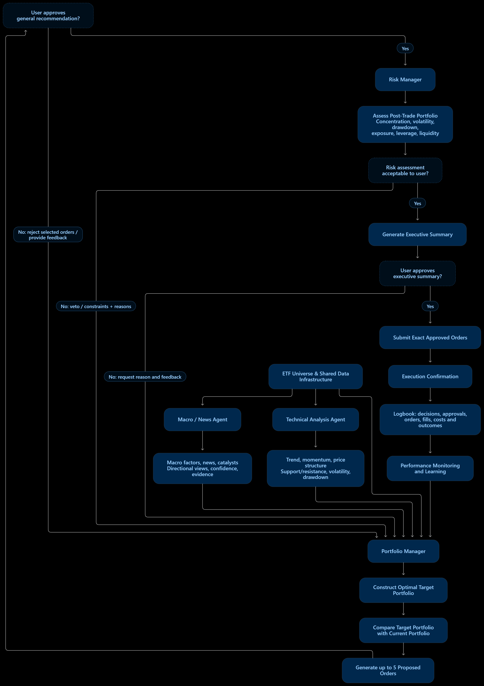

# QDC Trading — ReBel Agentic AI Challenge

A multi-agent system that trades 50 ETFs for the QTEM Data Challenge (Belfius × QuantumBlack, fall 2026).
The agents propose, a human approves every order.

## The competition

- €10,000, no transaction costs, at most 5 orders a day, on Mon 7, Thu 10, Mon 14, Thu 17 and Mon 21 December 2026.
- Graded on performance **and** method: critical thinking towards the agents, and re-assessment of the model.
- Mid-term report 22 Nov 2026 · final report 16 Jan 2027.
- Our reading of two open rules, each one setting in `data/config.py`: an order fills at the **last close before its
  day** (`FILL_AT_PREVIOUS_CLOSE`), and in **fractional units** (`ORDER_UNIT_DECIMALS`).

## How it works



| Step | What it does | Code |
|---|---|---|
| Data | Prices of the 50 ETFs, 37 indicators, ex-dividend dates | `data/` |
| Learning | Re-weights everything from what each expert earned (below), writes the lessons | `graph/review_loop.py`, `agents/learning.py` |
| Technical | Two scores: three rule answers weighted by what they earned since 2022, and Claude's reading of them | `agents/technical*.py` |
| Macro / News | Two scores: 15 macro views, and 20 theme analysts reading the news | `agents/macro_*.py` |
| Portfolio Manager | Combines the four scores, blends the code's portfolio with Claude's, picks at most 5 orders | `agents/portfolio*.py` |
| You | Review the orders | cockpit, Today page |
| Risk Manager | Measures the portfolio after your orders on 22 metrics; Claude writes an independent reading | `agents/risk*.py` |
| You | Review the risk, then sign off the summary; each review can send the day back or stop it | cockpit, Today page |
| Logbook | Writes the orders and an audit trail of the day, hash-chained | `agents/logbook.py` |

**One rule for every weight.** After each session, a weight is multiplied by e^(2 × what following that expert earned),
then the weights are rescaled to sum to 1 and kept between 5% and 80%. It weighs the technical agent's three answers
(since 2022), the four agents (since their first score), and Claude's portfolio against the code's.

**Two principles.** Code calculates, Claude judges: no LLM produces a number code could compute. Nothing is traded
without the three human reviews, and the trading rules are checked in code on every proposal and every approval.

## Get started

```bash
python3 -m venv .venv && .venv/bin/pip install -r requirements.txt   # Python 3.11+
cp .env.example .env                                                  # ANTHROPIC_API_KEY, EODHD_API_KEY; never commit it
.venv/bin/python -m pytest                                            # no test calls the network or Claude
streamlit run app/streamlit_app.py                                    # the cockpit
```

**Every weekday morning:** open the cockpit and click **Run the day** (about $4.30 of Claude, mostly Macro/News). The
scores and portfolios are logged before your first review, which is all the learning needs. Doing the three reviews
on practice days adds evidence of human judgement. Then commit `logs/` with `scripts/ship.sh "Add the days of …"`.

Without the cockpit: `python -m graph.pipeline` (runs to the first review), `--approve-all`, or `--answer file.json`.
To try something without touching the graded logs, point everything at a copy: `QDC_LOGS_DIR=/tmp/trial`.

## The cockpit

Dashboard · **Today** (your three reviews) · one page per agent · **Learning** (the weights and the backtest) ·
**How it works** (the diagram: click a box to see what it does and its code) · Logbook. A finished day is read from
its files in `logs/`, so any past day can be opened.

## Change the model

Every setting is one line. Test a change on the past first: add a line to `VARIANTS` in
`backtest/system_backtest.py` and run `python -m backtest.system_backtest --daily` (results and how to read them in
`backtest/README.md`).

| To change | Where |
|---|---|
| Competition rules, fill price, units, the learning speed and bounds, the agents' starting weights | `data/config.py` |
| The technical rules and the score of each answer | `agents/strategy_config.py` |
| How the portfolio is built, its hard limits, Claude's starting share | `agents/portfolio_config.py` |
| The risk reference levels | `agents/risk_config.py` |
| The macro factors and each ETF's exposure to them | `data/config.py`, `data/macro_exposure.csv` |
| What Claude is asked | the prompts in `agents/macro_analysts.py`, `agents/macro_llm.py`, `agents/technical_llm.py`, `agents/portfolio_llm.py` |

## Repository

```
data/       prices, indicators, the 50 ETFs, settings, every shared table (schemas.py) and its mock (mock.py)
agents/     technical, macro/news, portfolio manager, risk manager, logbook, and the learning rule
graph/      pipeline.py (one day, step by step) and review_loop.py (the learning step)
app/        the Streamlit cockpit
backtest/   the system replayed since 2022 (results in backtest/results/)
logs/       everything the agents said and the humans decided: graded evidence (logs/README.md)
tests/      one file per module
```

## Team

| | Scope |
|---|---|
| Axel | Macro / News, pipeline and learning, cockpit, backtest, repo |
| Achille | Data agent, technical agent |
| Alexander | Portfolio Manager, Risk Manager, Logbook |

Never push to `main`: ship with `scripts/ship.sh "what you changed"` (or `/ship` in Claude Code), and Axel merges.
Never commit `.env`, an API key or the Belfius / QuantumBlack documents. Full rules in `CLAUDE.md`.
