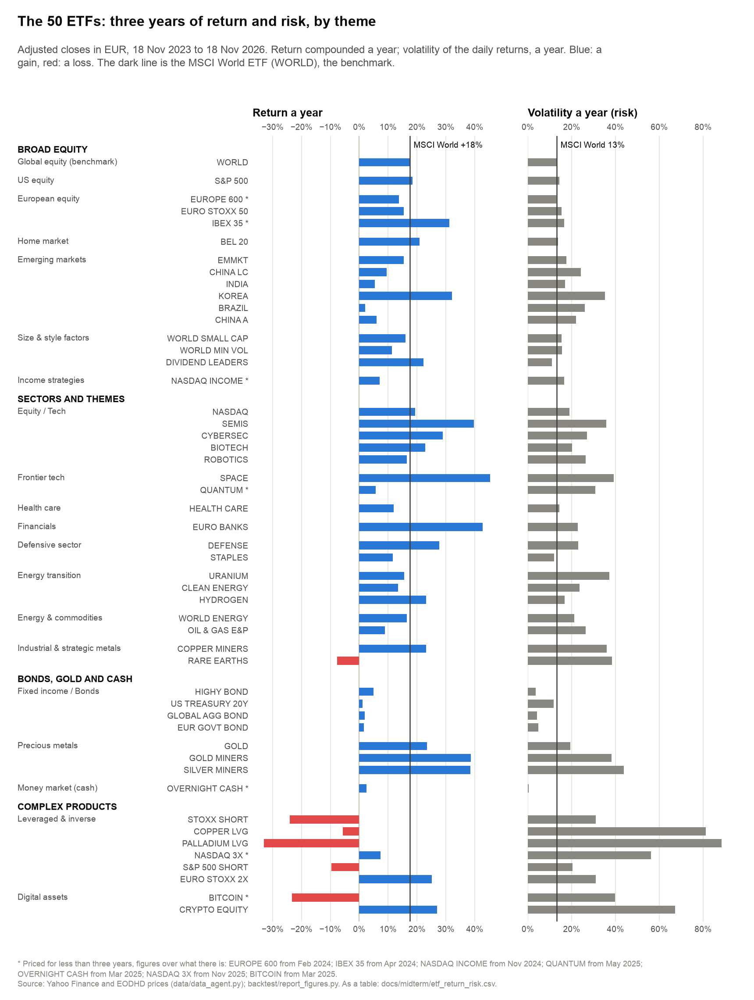
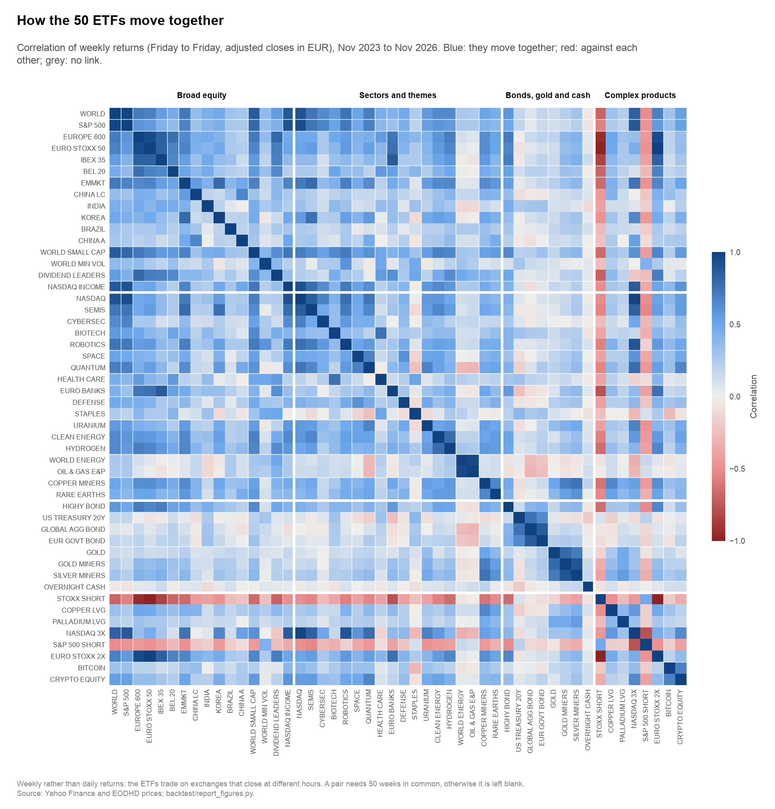
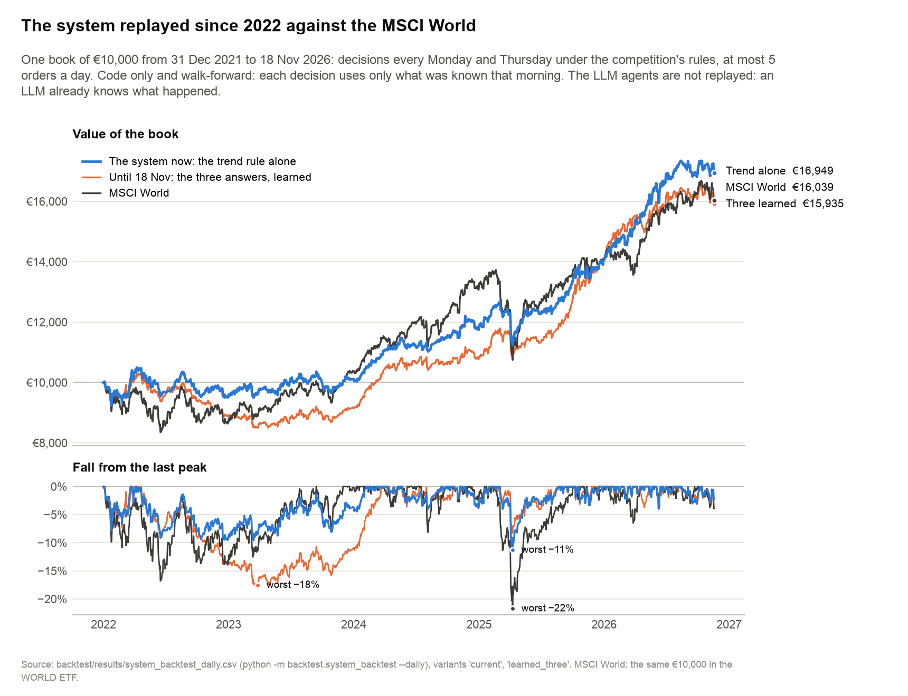
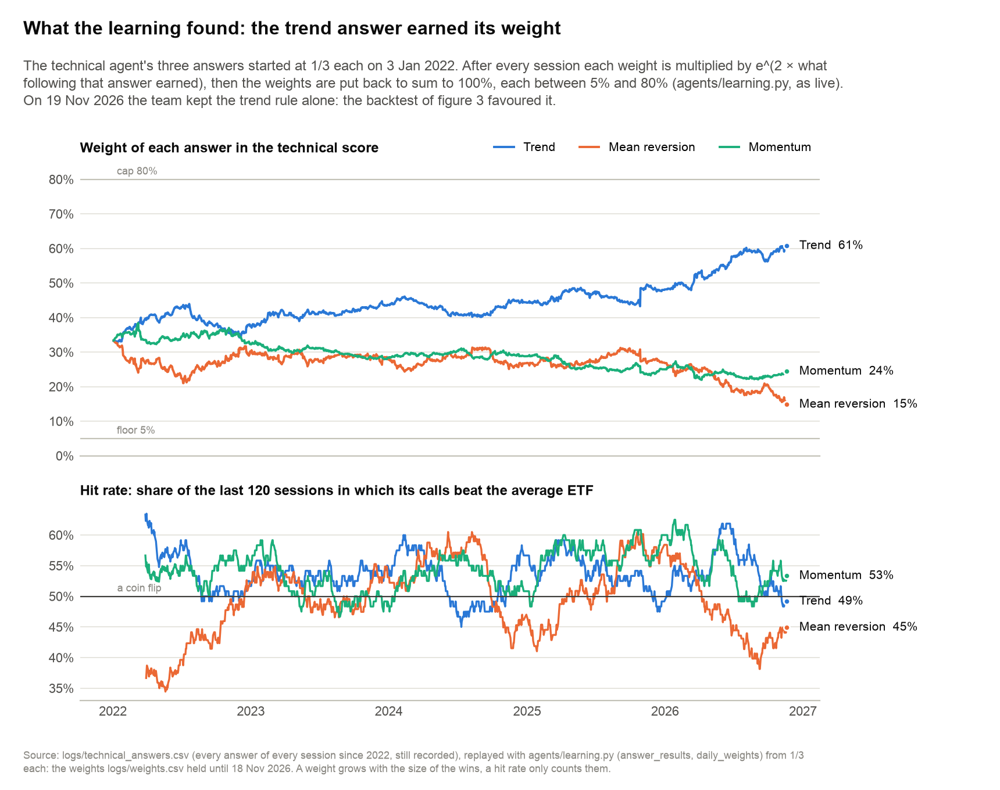
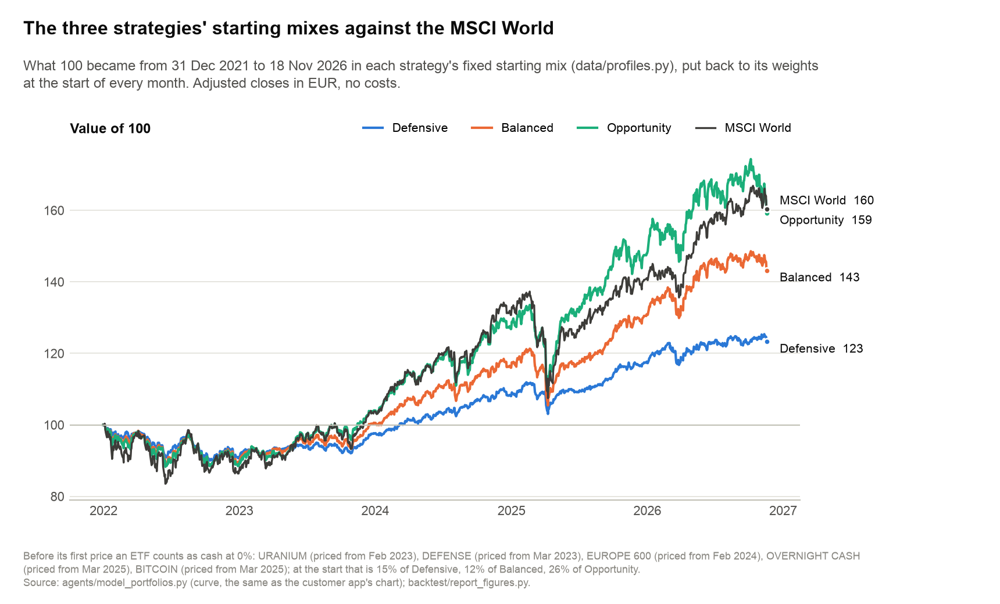

# Data exploration and preliminary results

Written by `python -m backtest.report_figures` on 2026-11-19: run it again and this page and the figures are rewritten. Prices: adjusted closes in EUR of the 50 ETFs (Yahoo Finance and EODHD, `data/data_agent.py`) up to 18 Nov 2026. Backtest: `backtest/results/`. Learning: `logs/technical_answers.csv` and `logs/weights.csv`.

## 1. The 50 ETFs over three years

Over the three years to 18 Nov 2026, the median ETF returned 15.5% a year with a volatility of 21.6%; the MSCI World ETF returned 17.6% for 13.3%. Returns run from PALLADIUM LVG (-33.0% a year) to SPACE (+45.3%), and risk from OVERNIGHT CASH (0.4%) to PALLADIUM LVG (88.5%): the list mixes very different kinds of risk, which is why each strategy caps themes and complex products. 7 ETFs have less than three years of prices: their figures cover what there is.

## 2. How the ETFs move together

Weekly returns, because the ETFs trade on exchanges that close at different hours. The median correlation between two ETFs is 0.25, and 57 pairs of the 1,225 are above 0.7 (4.7%), the closest EURO STOXX 50 and EURO STOXX 2X (1.00), WORLD and S&P 500 (0.98), NASDAQ and NASDAQ 3X (0.98): inside such a pair, holding both spreads little risk. The inverse ETFs are the only ones that move against the rest (the most negative pair, EURO STOXX 50 and STOXX SHORT at -1.00, is an index and its own inverse). Bonds are at 0.19 on average against broad equity, and gold at 0.14 against the MSCI World: they are what spreads the risk of the Defensive and Balanced mixes.

## 3. The system replayed since 2022

One book of €10,000 from 31 Dec 2021 to 18 Nov 2026, code only (an LLM cannot be replayed on the past: it already knows what happened), decisions every Monday and Thursday under the competition's rules, each from what was known that morning. The system ends at €16,949 against €16,039 in the MSCI World: +11.2% a year against +10.0%, with a volatility of 9.6% against 14.0% and a worst fall of -11.3% against -21.7%. Its Sharpe ratio is 1.07 against 0.69, 0.53 in the first half of the history and 1.60 in the second: most of the edge is recent. Over 5.0 years a Sharpe ratio is known to about ±0.56, so the gap with the market is a sign, not a proof.

The three technical answers learned together, as the system ran until 18 November, end at €15,935 with a Sharpe ratio of 0.96 and a worst fall of -17.6%. The trend rule alone did better in both halves of the history, with a smaller fall, and it is one rule to explain instead of three weights: on 19 November the team kept it alone (`agents/strategy_config.py`).

## 4. What the learning found

The learning rule (`agents/learning.py`) multiplies each weight by e^(2 × what following that expert earned) after every session. Starting the three technical answers at 1/3 each on 3 Jan 2022, it gave the most weight to trend (60.5% by 18 Nov 2026). Session by session, each answer beats the average ETF about as often as a coin flip (trend 53.6%, mean reversion 48.9%, momentum 54.4% of the sessions it made calls): the trend answer earned its weight by the size of its wins, not by being right more often. The rule still weighs the four agents and the LLM's portfolio against the code's, from their first live score: their record is a few sessions long (table).

| Level | Expert | Weight now | Since | Sessions judged | Hit rate |
|---|---|---:|---|---:|---:|
| technical | Trend | 100.0% | 2022-01-03 | 1238 | 53.6% |
| agents | macro_market | 25.4% | 2026-11-09 | 7 | 71.4% |
| agents | technical_det | 25.0% | 2026-11-09 | 8 | 75.0% |
| agents | macro_etf | 24.4% | 2026-11-11 | 5 | 80.0% |
| agents | technical_llm | 25.1% | 2026-11-16 | 2 | 100.0% |
| portfolio | code | 40.1% | 2026-11-16 | 2 | 50.0% |
| portfolio | llm | 59.9% | 2026-11-16 | 2 | 50.0% |

## 5. The three strategies' starting mixes

Each strategy's fixed starting mix (`data/profiles.py`), put back to its weights at the start of every month: the reference portfolio a customer sees before our engine publishes a version of it. Defensive returned +4.3% a year with a worst fall of -10.0%. Balanced returned +7.5% a year with a worst fall of -13.1%. Opportunity returned +9.8% a year with a worst fall of -18.2%. The MSCI World returned +10.0% with a worst fall of -21.7%: the calmer the mix, the smaller both the fall and the return. Before its first price an ETF counts as cash at 0%: URANIUM (priced from Feb 2023), DEFENSE (priced from Mar 2023), EUROPE 600 (priced from Feb 2024), OVERNIGHT CASH (priced from Mar 2025), BITCOIN (priced from Mar 2025); at the start that is 15% of Defensive, 12% of Balanced, 26% of Opportunity.

## Key numbers

| Measure | Value | Source |
|---|---:|---|
| ETFs with prices | 50 of 50 | prices |
| Median return / volatility a year, 3 years | 15.5% / 21.6% | prices |
| MSCI World return / volatility a year, 3 years | 17.6% / 13.3% | prices |
| Median correlation of two ETFs (weekly) | 0.25 | prices |
| Pairs above 0.7 | 4.7% | prices |
| System: value of €10,000, 31 Dec 2021 to 18 Nov 2026 | €16,949 (MSCI World €16,039) | system_backtest_daily.csv |
| System: return / volatility a year | +11.2% / 9.6% (MSCI World +10.0% / 14.0%) | system_backtest_daily_summary.csv |
| System: Sharpe ratio (± its error) | 1.07 ± 0.56 (MSCI World 0.69) | system_backtest_daily_summary.csv |
| System: worst fall | -11.3% (MSCI World -21.7%) | system_backtest_daily.csv |
| System: share of the market's moves (beta) | 0.52 | system_backtest_daily_summary.csv |
| System: orders over the whole history / trading rules broken | 1,002 / 0 | system_backtest_daily_summary.csv |
| Three answers learned (until 18 Nov): Sharpe / worst fall | 0.96 / -17.6% | system_backtest_daily_summary.csv |
| Trend answer's weight, learned from 1/3 | 60.5% | technical_answers.csv, agents/learning.py |
| Defensive since Dec 2021: return / volatility / worst fall / Sharpe | +4.3% / 5.8% / -10.0% / 0.61 | prices, data/profiles.py |
| Balanced since Dec 2021: return / volatility / worst fall / Sharpe | +7.5% / 8.7% / -13.1% / 0.78 | prices, data/profiles.py |
| Opportunity since Dec 2021: return / volatility / worst fall / Sharpe | +9.8% / 12.0% / -18.2% / 0.77 | prices, data/profiles.py |
| MSCI World since Dec 2021: return / volatility / worst fall / Sharpe | +10.0% / 14.0% / -21.7% / 0.69 | prices, data/profiles.py |

## Limits of these numbers

- The risk-free rate is the OVERNIGHT CASH ETF, priced only from 17 Mar 2025: before then it counts as 0%, which flatters every Sharpe ratio here a little (the ECB deposit rate reached 4% in 2023).
- Some ETFs have a shorter price history than the fund itself (the price source's listing): EUROPE 600 from Feb 2024, IBEX 35 from Apr 2024, NASDAQ INCOME from Nov 2024, QUANTUM from May 2025, OVERNIGHT CASH from Mar 2025, NASDAQ 3X from Nov 2025, BITCOIN from Mar 2025.
- The backtest replays the code only: the Macro/News agents, the LLM's technical reading and the LLM's portfolio are judged forward, by the learning step, from their first live day (9 November 2026).
- No transaction costs, as in the competition; orders fill at the last close before their day (`FILL_AT_PREVIOUS_CLOSE`, our reading of an open rule).
